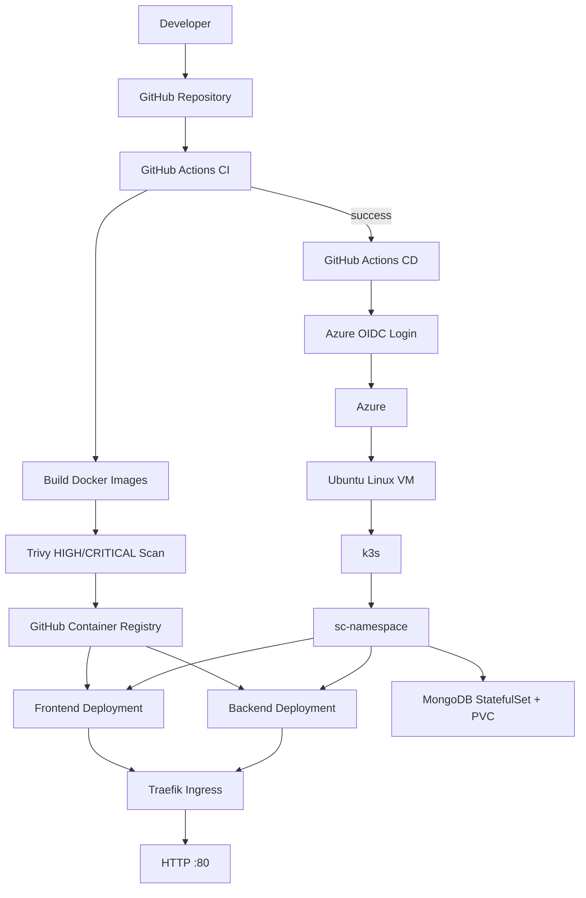
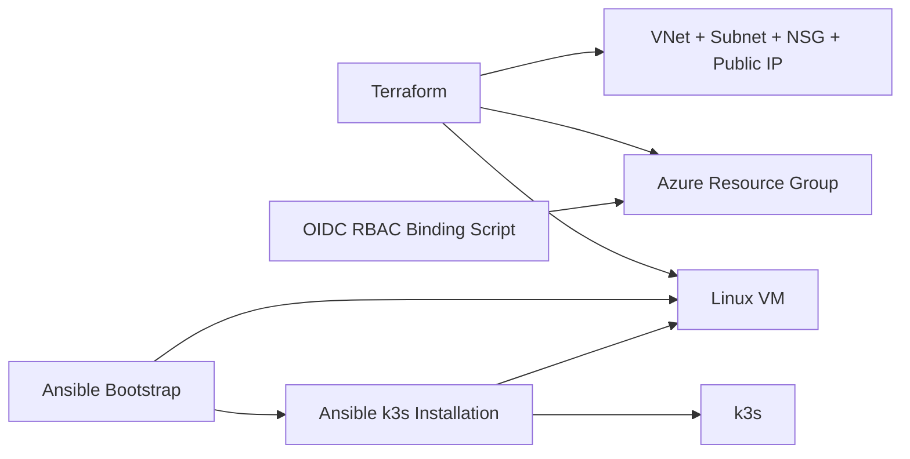
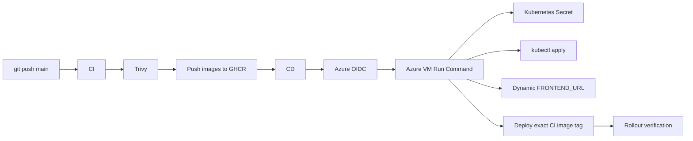

## DevOps Implementation

This repository extends an existing MERN-stack Smart Campus application with containerization, CI/CD, infrastructure as code, configuration management, and Kubernetes deployment.

### DevOps Toolchain

| Area | Tools |
|---|---|
| Application | React, Node.js, Express, MongoDB |
| Containerization | Docker, Docker Compose |
| CI/CD | GitHub Actions |
| Image Registry | GitHub Container Registry (GHCR) |
| Image Security | Trivy |
| Infrastructure as Code | Terraform, Azure |
| Configuration Management | Ansible |
| Container Orchestration | Kubernetes, k3s |
| Azure Authentication | Microsoft Entra ID + GitHub Actions OIDC |
| Azure Deployment | Azure VM Run Command |

### Architecture



### Infrastructure and Provisioning Flow



### CI/CD Flow



---

## Deployment

The Azure deployment is intentionally designed as a **temporary demonstration environment**. Terraform creates the disposable infrastructure, Ansible configures the VM and k3s, and GitHub Actions deploys the application.

The persistent pieces are:

- Terraform state storage in `tfstate-rg`
- The GitHub Actions Entra/OIDC application registration
- Its federated identity credential

The application resource group and VM are disposable and can be destroyed after collecting demo evidence.

### Repository Structure

```text
.
├── .github/
│   └── workflows/
│       ├── ci.yml
│       └── cd.yml
├── frontend/
├── backend/
├── k8s/
│   ├── backend/
│   ├── frontend/
│   ├── ingress.yml
│   └── namespace.yml
├── infra/
│   ├── terraform/
│   │   ├── main.tf
│   │   ├── ansible_hosts.tpl
│   │   └── ...
│   └── ansible/
│       ├── ansible.cfg
│       ├── inventory/
│       └── playbooks/
├── scripts/
│   └── bind-github-oidc-rbac.sh
├── docker-compose.yml
└── README.md
```

---

## Prerequisites

Install/configure the following locally:

- Git
- Docker
- Azure CLI
- Terraform
- Ansible
- SSH client
- `kubectl`

You also need:

1. An Azure for Students subscription or another Azure subscription.
2. An Azure account with permission to create the required resources and RBAC assignments.
3. A GitHub repository containing this project.
4. An SSH key pair, with the public key available at:
   ```bash
   ~/.ssh/id_rsa.pub
   ```
5. The application credentials required by the backend.

> **Cost warning:** Azure compute and networking resources can incur charges. This project is intended to be deployed temporarily, verified, recorded, and destroyed.

---

## 1. Configure Terraform State Storage

The Terraform state backend is intentionally persistent and is **not** created/destroyed by the main Terraform configuration.

Create:

```text
Resource Group:    tfstate-rg
Storage Account:   smartcampusscstate
Blob Container:    tfstate
State Key:         smart-campus.terraform.tfstate
Region:            India South Central
```

Example:

```bash
az login

az group create \
  --name tfstate-rg \
  --location indiasouthcentral

az storage account create \
  --name smartcampusscstate \
  --resource-group tfstate-rg \
  --location indiasouthcentral \
  --sku Standard_LRS

az storage container create \
  --name tfstate \
  --account-name smartcampusscstate \
  --auth-mode login
```

The Terraform backend is configured to use Azure AD authentication:

```hcl
backend "azurerm" {
  resource_group_name  = "tfstate-rg"
  storage_account_name = "smartcampusscstate"
  container_name       = "tfstate"
  key                  = "smart-campus.terraform.tfstate"
  use_azuread_auth     = true
}
```

---

## 2. Configure Azure Terraform Authentication

Authenticate locally:

```bash
az login
az account set --subscription "<YOUR_SUBSCRIPTION_ID>"
```

Verify:

```bash
az account show
```

The current Terraform configuration uses the authenticated Azure CLI identity.

---

## 3. Provision the Azure Infrastructure

Move into Terraform:

```bash
cd infra/terraform
```

Initialize:

```bash
terraform init
```

Format and validate:

```bash
terraform fmt
terraform validate
```

Review the plan:

```bash
terraform plan
```

Apply:

```bash
terraform apply
```

The configuration provisions the disposable Smart Campus environment, including:

- Resource group
- Virtual network
- Subnet
- Network security group
- Public IP
- Network interface
- Ubuntu Linux VM

The NSG permits SSH from the configured administrator IP and HTTP traffic on TCP port `80`.

> If your public IP changes, update the SSH source address in the Terraform NSG rule before applying.

---

## 4. Re-bind GitHub Actions OIDC to the New Resource Group

The GitHub Actions OIDC identity is intentionally **outside Terraform state** because the application resource group is disposable.

Terraform destruction removes the resource-group-scoped RBAC assignment, but it does not remove the persistent Entra application/federated credential.

After every fresh `terraform apply`, run:

```bash
cd ../..
```

Set the required values:

```bash
export AZURE_CLIENT_ID="<GITHUB_OIDC_CLIENT_ID>"
export AZURE_SUBSCRIPTION_ID="<YOUR_SUBSCRIPTION_ID>"
```

Authenticate:

```bash
az login
```

Run:

```bash
./scripts/bind-github-oidc-rbac.sh
```

The script grants:

```text
Virtual Machine Contributor
```

at this scope:

```text
smart-campus-resource-group
```

It is idempotent and will not create another assignment if the required assignment already exists.

Verify:

```bash
az role assignment list \
  --resource-group smart-campus-resource-group \
  --assignee "$AZURE_CLIENT_ID" \
  --output table
```

### Why this is separate from Terraform

The architecture deliberately separates:

```text
Terraform
    └── disposable Azure infrastructure

Persistent Entra OIDC identity
    └── GitHub Actions authentication

RBAC binding script
    └── reconnects persistent identity to recreated RG
```

This prevents `terraform destroy` from deleting the GitHub Actions identity.

---

## 5. Configure GitHub Actions OIDC

Create an Entra App Registration named:

```text
smart-campus-github-actions-cd
```

Create a federated credential for GitHub Actions.

The important values are:

```text
Issuer:
https://token.actions.githubusercontent.com

Audience:
api://AzureADTokenExchange

Repository:
almas-the-fixer/DevOpsify-Smart-Campus-Assistant

Branch:
main
```

The federated credential subject must match the subject presented by the GitHub Actions OIDC token.

> GitHub/Azure subject formats can include organization and repository identifiers. Use the exact subject shown by the Azure login failure/token configuration rather than guessing it.

Assign:

```text
Virtual Machine Contributor
```

to the App Registration's service principal at:

```text
smart-campus-resource-group
```

The `scripts/bind-github-oidc-rbac.sh` script automates this assignment after future Terraform recreations.

---

## 6. Add GitHub Repository Secrets

Go to:

```text
GitHub → Repository → Settings → Secrets and variables → Actions
```

Add:

### Azure OIDC secrets

```text
AZURE_CLIENT_ID
AZURE_TENANT_ID
AZURE_SUBSCRIPTION_ID
```

### Application secrets

```text
MONGO_URI
MONGO_USER
MONGO_PASS
JWT_SECRET
CLOUD_KEY
CLOUD_SECRET
EMAIL_USER
EMAIL_PASS
TWILIO_ACCOUNT_SID
TWILIO_AUTH_TOKEN
TWILIO_PHONE
```

Do **not** commit real values to Git.

The Kubernetes secret is generated during CD from GitHub Actions secrets.

---

## 7. Configure the VM with Ansible

Terraform creates the VM, but it does not install k3s.

Ansible owns VM configuration.

The Ansible inventory is generated by Terraform:

```text
infra/terraform/ansible_hosts.tpl
        ↓
infra/ansible/inventory/hosts.ini
```

Move to Ansible:

```bash
cd infra/ansible
```

Verify connectivity:

```bash
ansible all -m ping
```

Run the bootstrap playbook:

```bash
ansible-playbook playbooks/bootstrap.yml
```

This prepares the VM with the required basic packages.

Then install k3s:

```bash
ansible-playbook playbooks/install_k3s.yml
```

Verify from the VM:

```bash
ssh scadmin@<VM_PUBLIC_IP>
```

Then:

```bash
kubectl get nodes
```

Expected:

```text
sc-linux-machine   Ready
```

### Important

**CD does not install k3s.**

The ownership is:

```text
Terraform → infrastructure
Ansible   → VM + k3s
CD        → application
```

Therefore Ansible must be completed before the first CD deployment.

---

## 8. CI Pipeline

The CI workflow is:

```text
git push
   ↓
checkout
   ↓
Docker build
   ↓
Trivy scan
   ↓
GHCR push
```

The frontend and backend images are published to:

```text
ghcr.io/almas-the-fixer/
```

The images are tagged using the Git commit SHA.

### Important image-tag requirement

CI and CD must use the **same SHA format**.

The CI workflow currently uses Docker Metadata `type=sha`, while CD receives the full GitHub `workflow_run.head_sha`.

If CI publishes a shortened SHA but CD tries to pull the full 40-character SHA, Kubernetes will report:

```text
ErrImagePull
ImagePullBackOff
manifest unknown
```

Keep the tag strategy consistent. A robust option is to configure CI to publish the long SHA and have CD deploy that same long SHA.

---

## 9. CD Pipeline

CD runs after successful CI:

```yaml
on:
  workflow_run:
    workflows: ["smart-campus-asssistant-ci"]
    types: [completed]
    branches: [main]
```

The deployment process is:

```text
Successful CI
     ↓
Azure Login using OIDC
     ↓
Get VM public IP
     ↓
Azure VM Run Command
     ↓
Update application repository on VM
     ↓
Create Kubernetes namespace
     ↓
Create/update Kubernetes Secret
     ↓
Apply Kubernetes manifests
     ↓
Set dynamic FRONTEND_URL
     ↓
Set exact CI image tag
     ↓
Rollout frontend/backend
     ↓
Verify rollout
```

The CD workflow uses Azure VM Run Command so the GitHub runner does not need direct SSH access to the VM.

---

## 10. Kubernetes Deployment

The namespace is:

```text
sc-namespace
```

Apply manually for troubleshooting:

```bash
kubectl apply -f k8s/ -R
```

Check:

```bash
kubectl get pods -n sc-namespace
kubectl get svc -n sc-namespace
kubectl get ingress -n sc-namespace
```

Expected workloads include:

```text
MongoDB StatefulSet
Backend Deployment
Frontend Deployment
Traefik Ingress
```

The frontend and backend images come from GHCR.

MongoDB uses persistent storage through a Kubernetes PVC.

---

## 11. Dynamic Frontend URL

The backend allows the deployed frontend origin through:

```text
FRONTEND_URL
```

CD dynamically sets this to:

```text
http://<VM_PUBLIC_IP>
```

This avoids hardcoding the temporary Azure public IP in the repository.

---

## 12. Application Secret Handling

The original `k8s/backend/secrets.yml` is intentionally not committed with real credentials.

Instead:

```text
GitHub Actions Secrets
        ↓
CD
        ↓
Azure VM Run Command
        ↓
kubectl create secret ... --dry-run=client
        ↓
Kubernetes Secret
        ↓
Backend Deployment
```

The Secret is created in:

```text
sc-namespace
```

and consumed by the backend Deployment.

Never print secret values in CI/CD logs.

For a production deployment, a dedicated secret manager such as Azure Key Vault would be preferable. The current GitHub Secrets → Kubernetes Secret approach is intentionally lightweight for this temporary portfolio demonstration.

---

## 13. Manual End-to-End Deployment Checklist

For a completely fresh Azure environment:

### Infrastructure

```bash
cd infra/terraform

terraform init
terraform validate
terraform plan
terraform apply
```

### OIDC RBAC

```bash
az login

export AZURE_CLIENT_ID="<CLIENT_ID>"
export AZURE_SUBSCRIPTION_ID="<SUBSCRIPTION_ID>"

cd ../..
./scripts/bind-github-oidc-rbac.sh
```

### VM configuration

```bash
cd infra/ansible

ansible all -m ping
ansible-playbook playbooks/bootstrap.yml
ansible-playbook playbooks/install_k3s.yml
```

Verify:

```bash
ssh scadmin@<VM_PUBLIC_IP>
kubectl get nodes
```

### Application deployment

Push a change to `main`:

```bash
git add .
git commit -m "Deploy Smart Campus"
git push origin main
```

Then monitor:

```text
GitHub → Actions → CI Pipeline
GitHub → Actions → CD Pipeline
```

### Application verification

Get the VM IP:

```bash
az vm show \
  --resource-group smart-campus-resource-group \
  --name sc-linux-machine \
  --show-details \
  --query publicIps \
  --output tsv
```

Open:

```text
http://<VM_PUBLIC_IP>
```

Verify:

- Frontend loads
- Login works
- Backend API responds
- MongoDB is healthy
- Pods are `Running`
- Deployments report successful rollouts

---

## 14. Troubleshooting

### VM is unreachable

Check:

```bash
az vm show \
  --resource-group smart-campus-resource-group \
  --name sc-linux-machine \
  --show-details
```

Then verify the NSG allows TCP/80 and SSH from the configured administrator IP.

### `kubectl` does not work on the VM

k3s has not been installed or the Ansible configuration failed.

Run:

```bash
ansible-playbook playbooks/install_k3s.yml
```

Then:

```bash
kubectl get nodes
```

### Pods show `ErrImagePull` / `ImagePullBackOff`

Inspect:

```bash
kubectl describe pod <POD_NAME> -n sc-namespace
```

Look at the `Events` section.

If you see:

```text
manifest unknown
```

check that the image tag exists in GHCR and that CI/CD are using the same SHA format.

### Backend returns HTTP 500

Check:

```bash
kubectl logs deployment/smart-campus-backend -n sc-namespace
```

Then check:

```bash
kubectl get secret -n sc-namespace
kubectl describe deployment smart-campus-backend -n sc-namespace
```

Do not print secret values.

### Check the deployment image

```bash
kubectl get deployment smart-campus-backend \
  -n sc-namespace \
  -o jsonpath='{.spec.template.spec.containers[0].image}'
```

And frontend:

```bash
kubectl get deployment smart-campus-frontend \
  -n sc-namespace \
  -o jsonpath='{.spec.template.spec.containers[0].image}'
```

### Check rollout

```bash
kubectl rollout status deployment/smart-campus-frontend \
  -n sc-namespace

kubectl rollout status deployment/smart-campus-backend \
  -n sc-namespace
```

---

## 15. Destroy the Demo Infrastructure

When the demonstration is complete:

```bash
cd infra/terraform
terraform destroy
```

Verify that the disposable resource group no longer contains the VM and networking resources.

### Do not destroy these persistent components

Keep:

```text
tfstate-rg
smartcampusscstate
tfstate container
GitHub Actions OIDC App Registration
GitHub federated credential
```

The resource-group-scoped RBAC assignment disappears when the resource group is destroyed.

When infrastructure is recreated:

```text
terraform apply
       ↓
./scripts/bind-github-oidc-rbac.sh
       ↓
Ansible
       ↓
CD
```

This is the intended lifecycle.

---

## Known DevOps Design Decisions

### Why k3s instead of AKS?

The project uses a single Azure VM running k3s to keep the temporary portfolio deployment inexpensive while still demonstrating Kubernetes concepts.

### Why Terraform + Ansible?

Terraform handles **what infrastructure exists**.

Ansible handles **how the VM is configured**.

This keeps infrastructure provisioning and machine configuration separate.

### Why GitHub Actions OIDC?

The CD pipeline authenticates to Azure without storing an Azure client secret.

The Entra application and federated credential are persistent, while the RBAC assignment is scoped to the disposable application resource group.

### Why Azure VM Run Command?

The GitHub runner does not require inbound SSH access to perform deployment commands. Azure executes the deployment commands on the VM.

### Why are application secrets not committed?

Secrets are provided through GitHub Actions Secrets and converted into a Kubernetes Secret during deployment.

---

## Deployment Status

The project supports:

- Docker Compose local deployment
- Local k3s deployment
- Terraform Azure infrastructure provisioning
- Ansible VM and k3s configuration
- GitHub Actions CI
- Trivy container scanning
- GHCR image publishing
- GitHub Actions CD
- Azure OIDC authentication
- Kubernetes deployment through Azure VM Run Command
- Dynamic frontend URL configuration
- Kubernetes Secret injection
- Disposable Azure demonstration infrastructure

---


# Smart Campus Assistant - MERN Stack**


![MERN Stack]\(https\://img.shields.io/badge/Stack-MERN-blue)

![React]\(https\://img.shields.io/badge/Frontend-React.js-61DAFB)

![Node.js]\(https\://img.shields.io/badge/Backend-Node.js-339933)

![Express.js]\(https\://img.shields.io/badge/API-Express.js-black)

![MongoDB]\(https\://img.shields.io/badge/Database-MongoDB-47A248)

![Status]\(https\://img.shields.io/badge/Status-Completed-brightgreen)


Smart Campus Assistant is a full-stack MERN web application designed to manage academic and campus-related workflows through separate role-based panels for Admin, Faculty, and Students.


The project focuses on secure authentication, role-based access control, timetable management, attendance workflows, academic data handling, notifications, result management, and clean dashboard-based UI.


\---


**## Live Links**


\- Project Live Link : [Open Smart Campus Assistant]\(https\://smart-campus-assistant-eight.vercel.app)


\---


**## Project Overview**


Smart Campus Assistant provides a centralized platform for managing campus operations digitally.


It includes different panels for:


\- Admin

\- Faculty / Teacher

\- Student


Each role has access to specific features based on permissions. The application is built with a scalable MERN architecture and follows a clean separation between frontend, backend, routes, controllers, models, middleware, and services.


This project was originally created as an academic project and has been prepared as a demo-safe MERN portfolio project using anonymized/sample data.


\---


**## Screenshots**


**### Home Page**


![Home Page]\(screenshots/HomePage.png)


**### Login Page**


![Login Page]\(screenshots/LoginPage.png)


\---


**## Key Features**


**### Authentication & Authorization**


\- User registration and login

\- JWT-based authentication

\- Secure password hashing using Bcrypt

\- Role-based access control

\- Protected frontend routes

\- Protected backend APIs

\- Separate access for Admin, Faculty, and Students


**### Additional Features**


\- Dark mode support

\- Timetable conflict detection

\- Real-time style notification workflow

\- Attendance tracking and reporting


**### Admin Panel**


\- Admin dashboard

\- Manage students

\- Manage faculty members

\- Manage subjects

\- Manage timetable data

\- Manage attendance-related records

\- Manage academic results

\- View campus-related data from a centralized dashboard

\- Upload academic data using bulk upload features

\- Control role-based access and user information


**### Faculty / Teacher Panel**


\- Faculty dashboard

\- View assigned subjects

\- View timetable

\- Manage attendance for assigned lectures

\- Access student-related academic data

\- View notifications

\- Interact with academic workflows through a dedicated faculty interface


**### Student Panel**


\- Student dashboard

\- View timetable

\- View attendance details

\- View subjects

\- View academic result information

\- View notifications

\- Access campus-related information through a clean student interface


**### Timetable Management**


\- Structured timetable management

\- Subject-wise scheduling

\- Faculty-wise lecture allocation

\- Student-side timetable viewing

\- Faculty-side timetable viewing

\- Admin-side timetable management

\- Support for academic scheduling workflows


**### Attendance Management**


\- Attendance-related workflow support

\- Faculty-side attendance handling

\- Student-side attendance viewing

\- Attendance records stored in MongoDB

\- PDF/report generation support for attendance data

\- Demo-safe data can be used for public deployment


**### Notification System**


\- Role-based notification support

\- Admin-to-user communication workflow

\- Student and faculty notification views

\- Centralized notification handling


**### Bulk Upload Support**


\- Bulk upload support for academic data

\- CSV-based data insertion workflow

\- Useful for adding users, timetable, subjects, and academic records

\- Helps quickly populate demo or academic databases


**### Frontend Features**


\- Clean and responsive user interface

\- Dashboard-based layout

\- Role-based navigation

\- Reusable React components

\- Form validation

\- Error handling

\- Fast routing using React Router

\- API integration using Axios


**### Security Features**


\- JWT authentication

\- Password hashing with Bcrypt

\- Protected routes

\- Middleware-based API protection

\- Role-based authorization

\- Environment variables for sensitive configuration

\- Demo mode support for safe public deployment


\---


**## Tech Stack**


**### Frontend**


\- React.js

\- React Router DOM

\- Axios

\- JavaScript

\- CSS / Tailwind CSS / Bootstrap

\- Vite


**### Backend**


\- Node.js

\- Express.js

\- MongoDB

\- Mongoose

\- JWT

\- Bcrypt.js

\- Multer / File Upload Support

\- dotenv


**### Integrations / Services**


\- Cloudinary support for file or image uploads

\- Email service support

\- SMS service support

\- PDF/report generation support


**### Tools**


\- Git

\- GitHub

\- Postman

\- VS Code

\- MongoDB Atlas

\- Vercel

\- Render


\---


**## Project Structure**


Smart-Campus-Assistant-MERN/

&#x20;   ├── frontend/

&#x20;   ├── backend/

&#x20;   ├── infra/

&#x20;   │   ├── terraform/

&#x20;   │   └── ansible/

&#x20;   ├── k8s/

&#x20;   ├── screenshots/

&#x20;   ├── .github/

&#x20;   │   └── workflows/

&#x20;   ├── docker-compose.yml

&#x20;   ├── Dockerfile...

&#x20;   ├── .gitignore

&#x20;   └── README.md

**---**


**## Demo Credentials**


Recommended demo accounts:


&#x20;   Name: Student

&#x20;   Email: student\@campus.com

&#x20;   Password: Abcd\@1234


Note: These credentials are only for demo deployment with sample data.


\---


**## Deployment**


Recommended deployment setup:


&#x20;   Frontend: Vercel

&#x20;   Backend: Render

&#x20;   Database: MongoDB Atlas


\---


**## Demo Safety Notes**


This project is prepared as a demo-safe portfolio project.


\- Real academic data should not be used in public deployment.

\- Demo deployment should use anonymized sample data.

\- Private documents, PPT files, PDFs, and college-related documentation should not be committed to GitHub.

\- Sensitive credentials must be stored only in deployment dashboards such as Render and Vercel.

\- .env files are not included in the repository.


\---


**## Future Enhancements**


\- Payment integration for academic fees and campus services

\- Online exam integration with secure assessment workflows

\- Advanced result analysis with performance insights

\- First-rank and second-rank highlighting based on academic performance

\- AI-powered 24/7 student and faculty helper

\- Smart academic recommendations based on attendance, results, and timetable data

\- Advanced reporting dashboard for admins

\- Mobile app integration for Android and iOS


\---


**## Developer**


&#x20;   Name: Harshrajsinh Vaghela

&#x20;   Role: MERN Stack Developer

&#x20;   Project: Smart Campus Assistant - MERN Stack

&#x20;   Location: Ahmedabad, Gujarat, India


GitHub: [harshrajsinhvaghela7586]\(https\://github.com/harshrajsinhvaghela7586)


Portfolio: [Harshrajsinh Vaghela Portfolio]\(https\://portfolio-seven-beige-78.vercel.app/)


LinkedIn: [Harshrajsinh Vaghela]\(https\://www\.linkedin.com/in/harshrajsinh-vaghela-a38bba300/)


\---


**## License**


This project is developed for academic learning and portfolio demonstration purposes.


\---


**## Acknowledgement**


Thank you for checking out this project.


If you found this project useful or interesting, feel free to star the repository.
